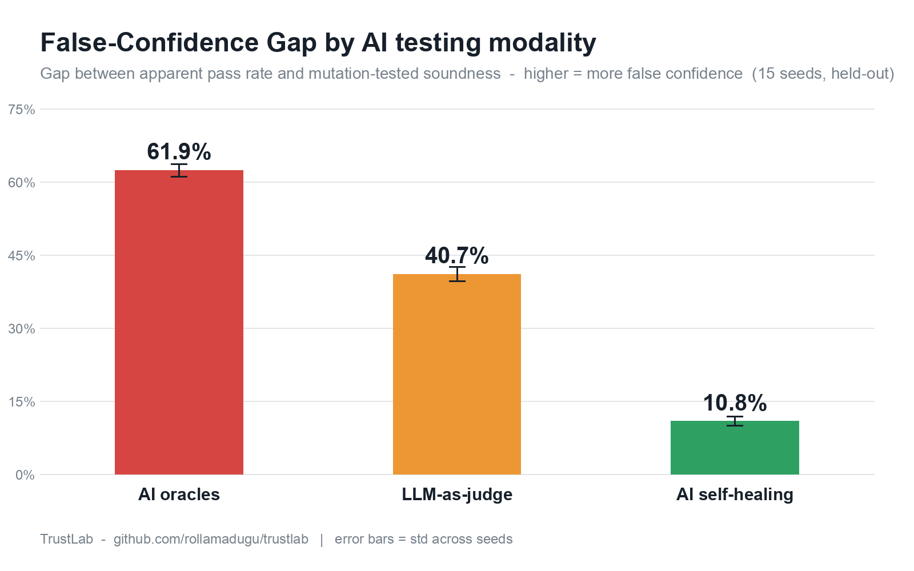
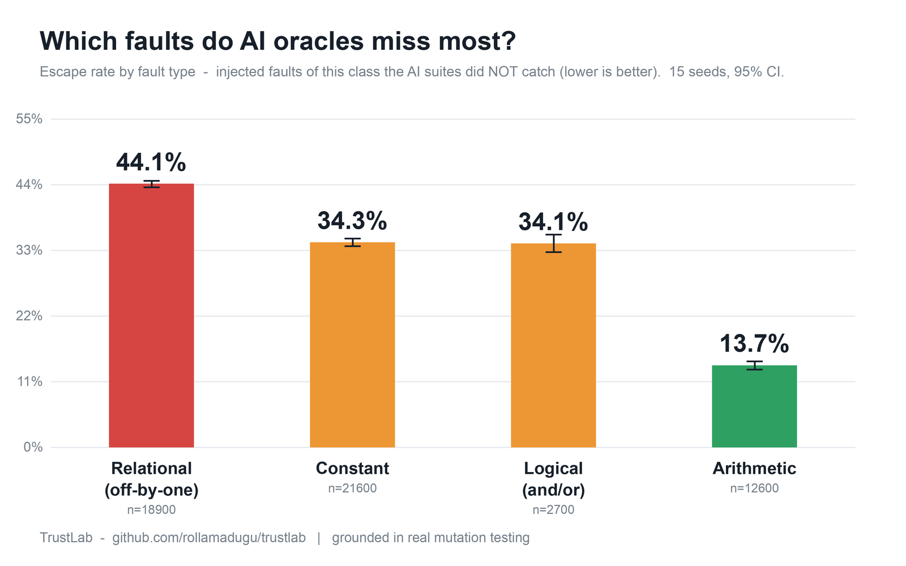
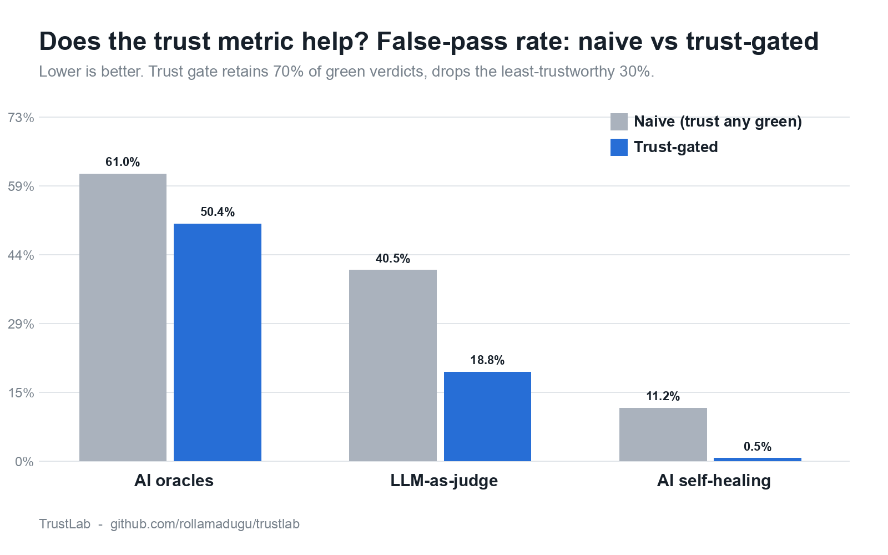

# TrustLab — Trust in AI-Driven Software Testing

[](https://github.com/rollamadugu/trustlab/actions/workflows/main.yml)


> **When an AI says your test "passed", can you believe it?**

Modern teams let AI **generate** test oracles, **heal** broken UI locators, and
**adjudicate** pass/fail (LLM-as-judge). Each can return a **GREEN** result that is
not actually sound — a *false pass* that creates false confidence. **TrustLab**
measures how often that happens (the **False-Confidence Gap**) and builds a
**calibrated trust metric** that predicts which green verdicts can be believed —
grounded in **real mutation testing**, so "sound" is objective, not opinion.

Pure Python standard library (+ `pytest` for tests). Runs on any laptop. No GPU,
no LLM API, no cloud.

---



## Headline results (15 seeds, held-out evaluation)

| Modality | Grounding | False-Confidence Gap (95% CI) | Trust ROC-AUC (naive = 0.50) | ECE | False-pass rate: naive → trust (top 70%) |
|---|---|---|---|---|---|
| AI-generated oracles | **real** (mutation-tested) | 61.9% [61.3, 62.6] | 0.757 | 0.076 | 61% → 50% |
| AI self-healing | modelled (behind adapter) | 10.8% [10.3, 11.2] | 0.947 | 0.042 | 11% → **0.5%** |
| AI adjudication | modelled (behind adapter) | 40.7% [40.0, 41.5] | 0.944 | 0.045 | 40% → **19%** |

95% CIs are percentile bootstrap across 15 seeds. All effect sizes "large"
(Vargha–Delaney A12 0.76–0.95), Mann–Whitney p < 0.001.

> **Read the grounding column carefully.** Only the **oracle** result is a *real*
> measurement — soundness is decided by a live AST mutation engine. The
> **healing** and **adjudication** results are empirically-shaped *models* of
> documented tool/LLM behaviour, placed behind an adapter seam so a real tool can
> be dropped in unchanged (see [Pre-registration](PREREGISTRATION.md) for the
> planned real-LLM-judge run). The numbers for those two describe the model, not
> a real tool — don't read them as measured behaviour.

**Secondary finding — the gap tracks code structure.** For AI-generated oracles,
branch-heavy `grade` (99.7%) and `triangle_type` (93.6%) are far more dangerous
than simple `classify_bmi` (5.2%).

**Which faults escape? (real mutation testing, by operator class)**



Breaking the oracle result down by *fault type* is more actionable than one
combined number: **relational / off-by-one faults escape most (44.1%)**, while
arithmetic faults are caught far more often (13.7%). So AI-generated assertions
are weakest exactly on boundary conditions — the bugs that bite in production.



The trust metric does not just score — it acts. Dropping the least-trustworthy
30% of green verdicts cuts the silent false-pass rate dramatically for healing
(11% → 0.5%) and adjudication (40% → 19%), while a naive "trust any green"
policy cannot distinguish them at all (ROC-AUC 0.50 by construction).

## Why this is a research result, not just a tool

It defines and **measures a phenomenon** (the False-Confidence Gap), grounds truth
in **mutation testing**, builds a **calibrated metric** evaluated with statistics
(ROC-AUC, Mann–Whitney U, Vargha–Delaney A12, ECE) against a baseline,
**generalises across three modalities**, and ships a **released benchmark**.

## Repository layout

```
trustlab/
  sut/            subject programs + real AST mutation engine (ground-truth faults)
  modalities/     oracles.py (mutation-grounded) · healing.py · adjudication.py
  verdict.py      the common Verdict record used by all modalities
  trust/metric.py unified calibrated trust metric + False-Confidence Gap
  metrics/stats.py ROC-AUC, Mann–Whitney U, Vargha–Delaney A12, ECE
  benchmark.py    builds the labelled verdict corpus -> results/trust_benchmark.json
experiments/      exp1 (the phenomenon) · exp2 (the metric vs naive) · exp3 (escape by operator)
tests/            full pytest suite (29 tests)
results/          experimental result artefacts (JSON)
```

## Quick start

```bash
python3 -m venv .venv && source .venv/bin/activate
pip install -e ".[dev]"

pytest                                            # 29 tests
python -m experiments.exp1_false_confidence_gap   # the phenomenon (with 95% CIs)
python -m experiments.exp2_trust_metric           # the metric vs naive
python -m experiments.exp3_escape_by_operator     # escape rate by fault type
python -m trustlab.benchmark                      # build the labelled benchmark
```

## How soundness is measured (honesty)

* The **oracle** modality's soundness is *real*: an AST mutation engine injects
  faults and a verdict is sound only if it actually catches them (statement
  coverage is measured at runtime).
* The **self-healing** and **adjudication** modalities are empirically-shaped
  *models* of documented tool/LLM behaviour, placed behind an adapter interface
  (`generate_*_verdicts` + `Verdict`) so a real Playwright self-healer or real LLM
  judge can be substituted without changing the trust metric or the experiments.

## Citation

If you use TrustLab, please cite:

```
Rollamadugu, K. (2026). Trust in AI-Driven Software Testing: Measuring the
False-Confidence Gap and a Calibrated Trust Metric. Preprint.
```

*(A preprint DOI/arXiv ID will be added here once released.)*

## Author

**Krishnasai Rollamadugu** — Test Automation Architect · researching trust in
AI-driven software testing. ORCID: 0009-0001-9992-8997

## License

MIT — see [LICENSE](LICENSE).
